# BIOME-next — illustrated user guide

3.0.0-alpha.7 · Windows x64 · October 26, 2026

BIOME-next continues [BIOME 2.x](https://github.com/UniversalBuilder/BIOME) with a redesigned, folder-based architecture. Development continues in this repository. This alpha currently has a French interface; English by default and optional translation packs are planned. The French control names below match the application. A [detailed French guide](guide-utilisateur.fr.md) is also available.

Since alpha.3, message imports accept 50 MB and individual illustrations 10 MB; some alpha.2 screenshots still show older limits. Each entry accepts 100 MB total and image extraction is capped at 50 MB.

All screenshots show the real application with fictional identities, generated images and example time records. They contain no research or personal project data.

## Workflow and storage

**Request → project → retained originals → scope → notebook and experiments → delivery → activity report.**

A short consultation may need just images, a note, time spent and the final answer. Training can add documented trials and a tutorial. Development adds script versions and instructions. A full analysis can reference large datasets and deliver outputs for the researcher to interpret.

| Item | What it stores |
| --- | --- |
| Catalogue | Project records, notebook, directory, scripts, small attachments, receipts, trash and delivery snapshots |
| Separate original-data folder | Images and large files on a local disk, external drive or NAS |
| Delivery ZIP | A frozen copy of explicitly selected material and project context |
| Local application settings | Last catalogue, logs and state in `%LOCALAPPDATA%/BIOME` |

Back up original data separately from the catalogue. Referencing a folder does not copy its contents.

## 1. Install and start

Download `BIOME-Windows-portable-3.0.0-alpha.7.zip` from the [release](https://github.com/UniversalBuilder/BIOME-next/releases/tag/v3.0.0-alpha.7), extract the entire archive and launch `BIOME/BIOME.exe`. Keep `_internal` beside the executable. No separate Python installation is needed. Chrome or Edge provides the dedicated application window. This preview is unsigned.

On first launch, create a catalogue, open an existing one or install the demo. Subsequent launches remember the selected catalogue. Use **Quitter BIOME** to stop the local application service when finished.

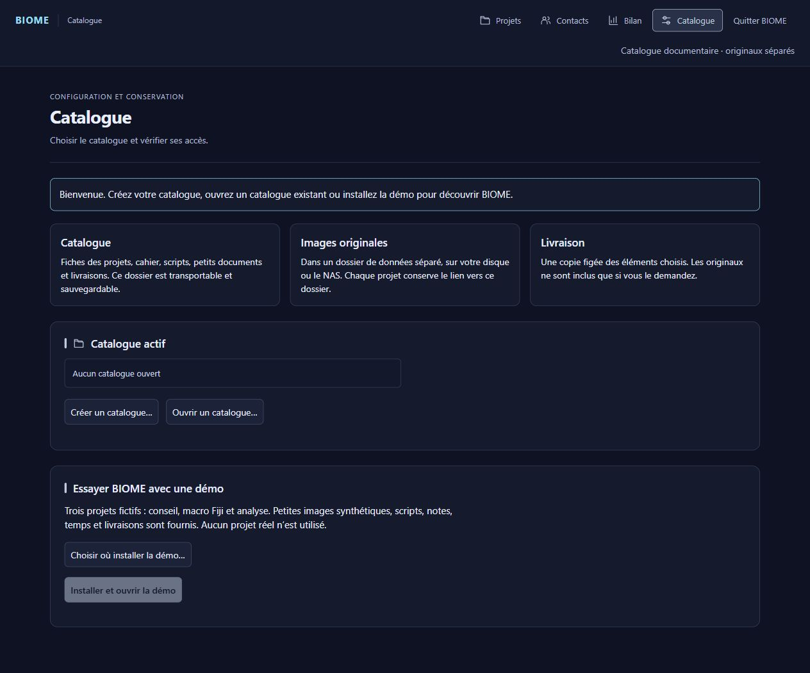

## 2. Choose a catalogue or install the demo

In **Catalogue**, **Créer un catalogue…** asks for a name and parent folder and creates a new subfolder without overwriting an existing one. **Ouvrir un catalogue…** opens a recognized catalogue. **Catalogues récents** returns to a previous one.

**Essayer BIOME avec une démo** installs three fictional projects: advice, Fiji macro development and synthetic image analysis. `BIOME-Demo/Catalogue` and `BIOME-Demo/Originals` remain separate. An existing demo installation is never overwritten; choose another destination for another copy.

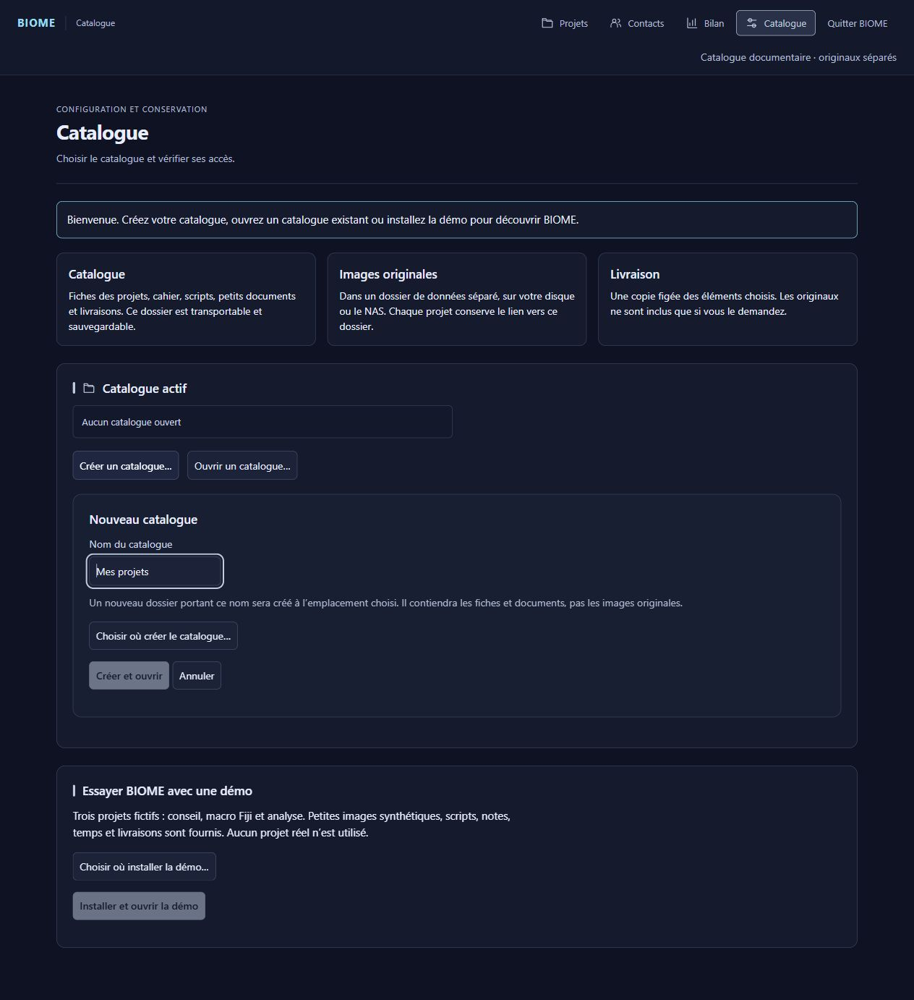

## 3. Find projects

**Projets** supports search by title, contact or group and filtering by status. Click column headers to sort by project, group/contact, status, creation or last activity; click again to reverse the order. Unknown dates remain unknown. Open a project by clicking its title.

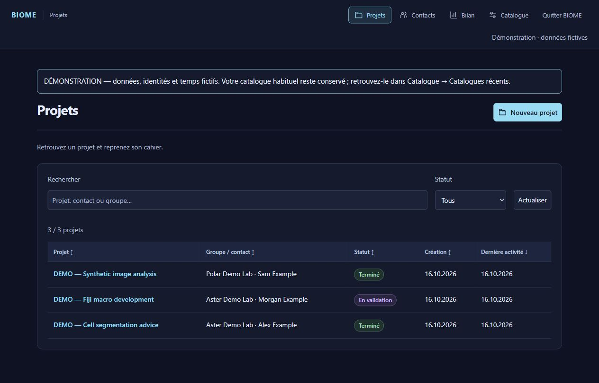

## 4. Create and correct a project

**Nouveau projet** requires a title, contact and initial request. Email, group and the separate original-data folder are optional. Reuse directory suggestions to avoid spelling variants. The project starts at **À cadrer** and retains the initial request as a notebook entry.

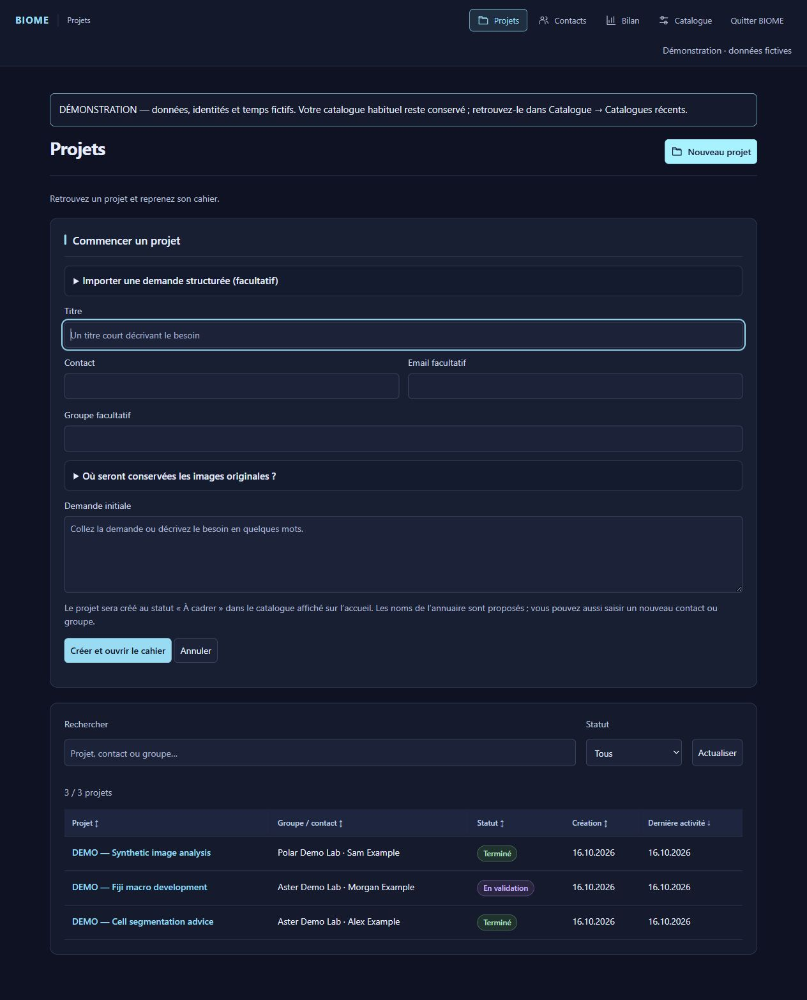

**Importer une demande structurée** accepts `.msg`, `.eml`, `.txt` or pasted form answers with explicit labels such as `Project title`, `Contact Email` and `Research group`. It preserves already-filled fields. This is not AI extraction from free-form email: unstructured email text is retained, while identity fields require review and manual completion.

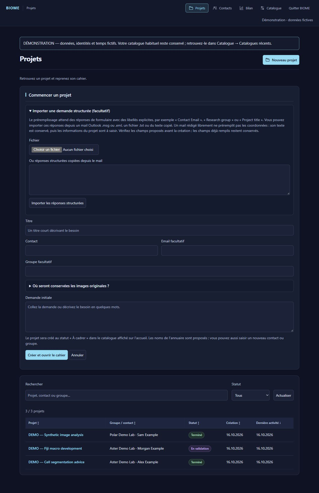

**Modifier les informations** corrects title, contact, email and group. Lists and activity reports reflect the correction; the folder name, original request and previously created deliveries remain unchanged.

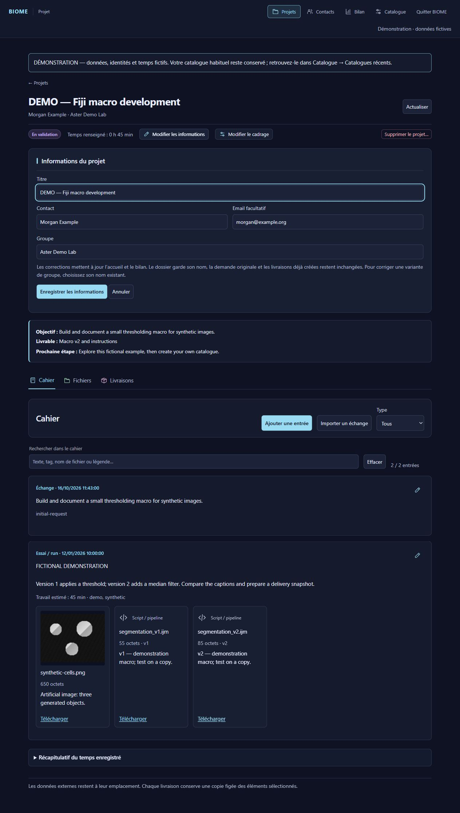

## 5. Record the agreed scope

**Modifier le cadrage** stores status, main intervention, objective, expected deliverable and next step. Validation criteria, software, imaging modalities and analysis topics are optional. The next step is the current reminder; dated experiments and decisions belong in the notebook.

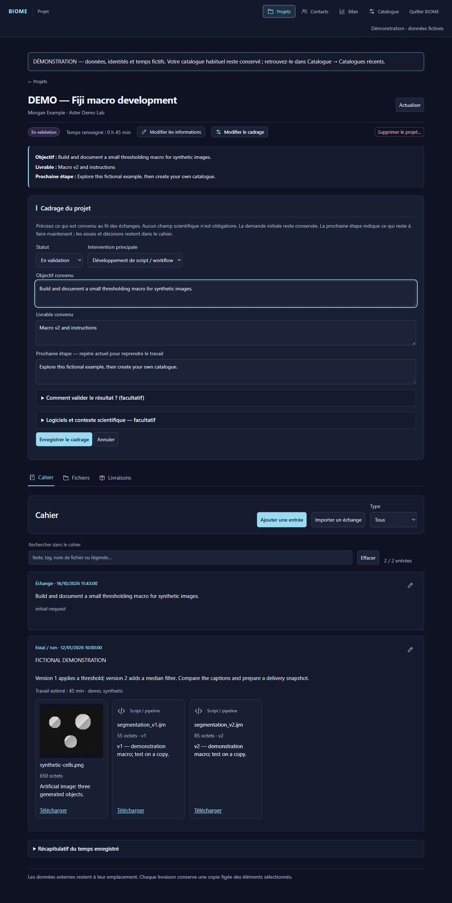

## 6. Notebook, time and imported exchanges

**Cahier** has dated work notes, experiments, meetings, exchanges and decisions. Search includes text, tags, filenames and captions. **Modifier** edits an entry; **Actualiser** rereads project files.

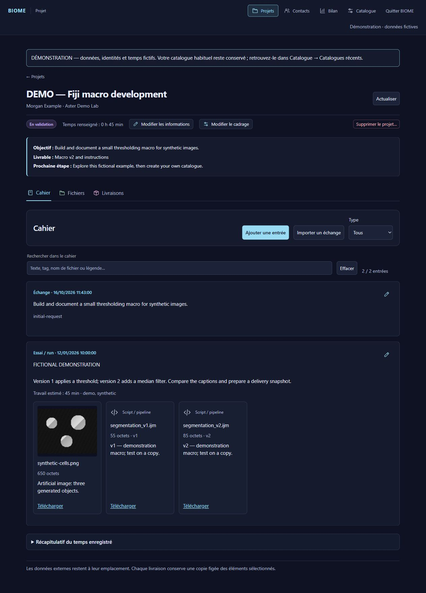

**Ajouter une entrée** records type, activity date and time, text, optional estimated human minutes, tags and small attachments. Enter time once per session even if several notes describe it. Leave it empty when unknown or already counted; missing time does not mean no work. Attachments are limited to 100 files, 10 MB each (50 MB for a message or text file) and 100 MB total; use **Fichiers** for large data.

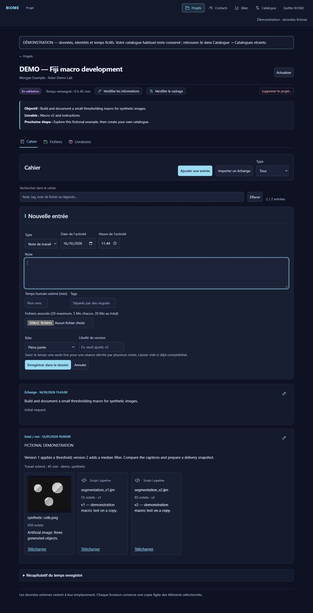

**Importer un échange** prepares an entry for review from `.msg`, `.eml`, `.txt` or pasted text. Outlook `.msg` can retain the original message and extract illustrations subject to content and size limits. Attachments inside `.eml` remain in the source message. Review date, text and files before saving.

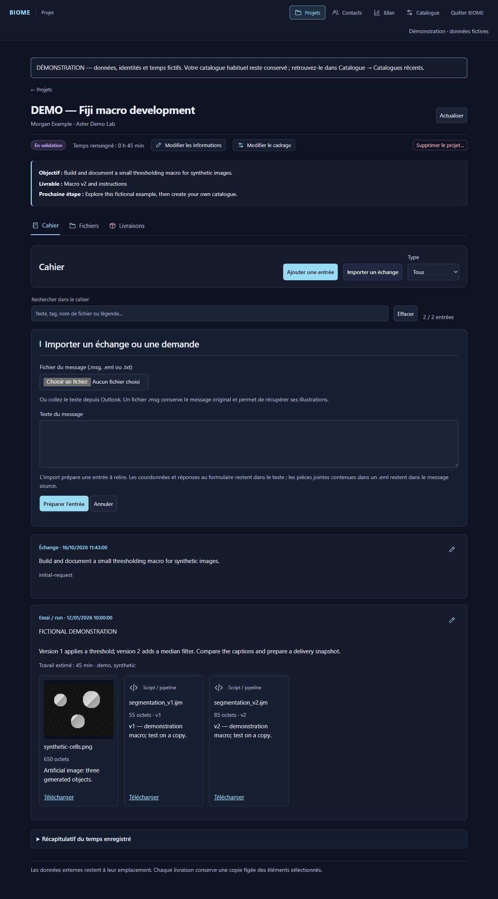

Saved Markdown notes can be edited externally. Refresh to read those changes. If the file changes after opening its BIOME edit form, conflict protection prevents silently overwriting the intervening version. Merely opening a file in VS Code does not change or lock it.

## 7. Files, originals and scripts

**Fichiers** separates linked/retained datasets from notebook attachments. **Ajouter des données** records a location and purpose without copying data. Expand **Voir le chemin**, open its containing folder, or edit the reference. Image attachments can be enlarged; download attachments or use **Voir dans le cahier** to find their original entry.

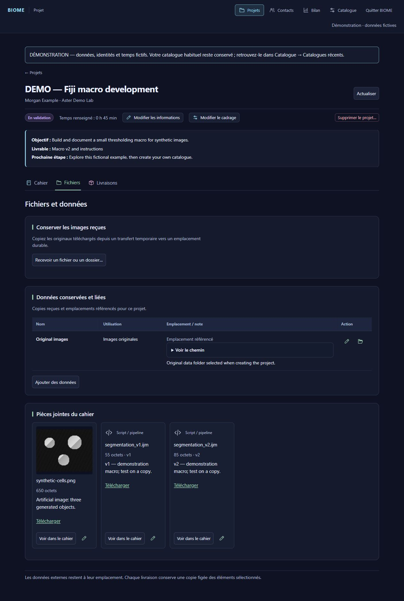

**Recevoir un fichier ou un dossier…** prepares a verified copy of downloaded originals into durable storage separate from the catalogue. Select the source, name the dataset, prepare the receipt and choose the destination. BIOME verifies copied content by hashes, keeps a provenance receipt and preserves the source. New catalogues keep original-data storage separate.

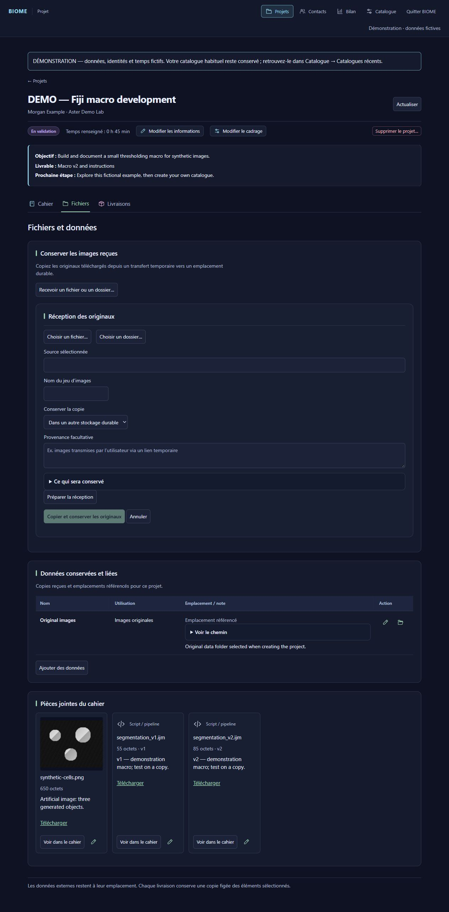

For scripts, choose **Version de script / pipeline** when attaching a file. The pencil action later edits the version label and caption, for example `v3 — median filter added`. It changes metadata, not the original filename or script content. Attach a new file for a new script version. This complements, rather than implements, Git source versioning.

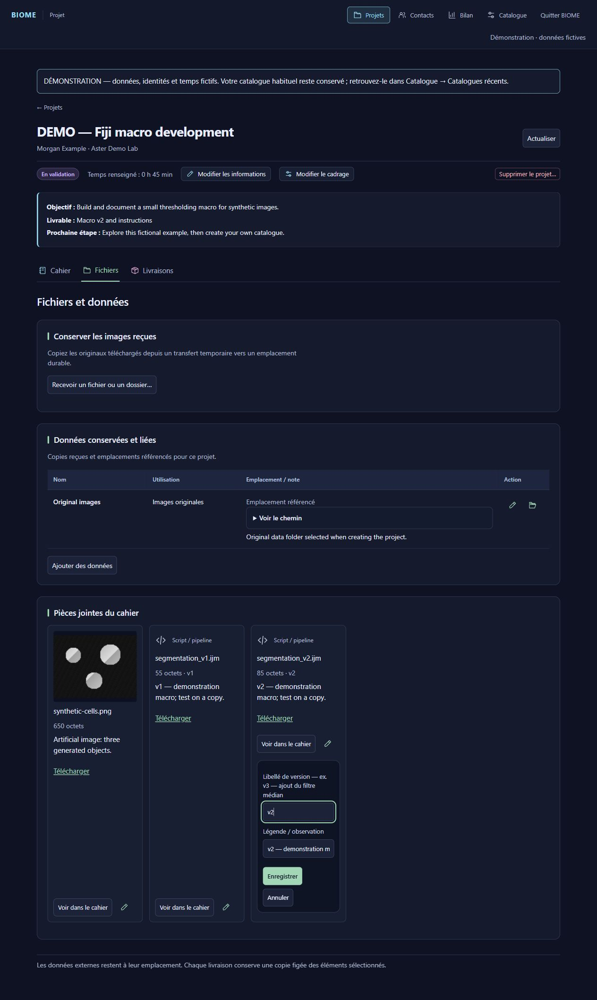

## 8. Deliver a frozen result

**Livraisons → Préparer une livraison** selects files and a recipient message. For linked datasets explicitly choose to omit them, mention their path or copy their contents into the ZIP. A local path may not be accessible to the recipient. Large included data requires disk space and time.

Each ZIP freezes the chosen content and project context. Later edits do not rewrite past deliveries. Download and send the ZIP using your usual channel; BIOME does not send it automatically. Create another numbered delivery for a correction.

Contents are grouped by notebook entry, with their date, original filename, caption and version. Click a row to preview it; check its checkbox to include it. Search and type filters preserve your selection. Images can be enlarged; scripts and messages have text previews. Source messages and technical archives are separate and included only when explicitly checked.

**Modifier le libellé** changes the display label for this delivery only. Source filenames and notebook metadata remain unchanged. Use **Vérifier la livraison** to review the selected documents and linked-data choices, then write the recipient message and create the ZIP. If a file changed since selection, refresh the project and review it again. The project context and history are included automatically; unselected notebook content is not.

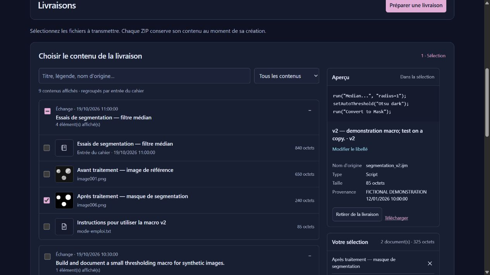

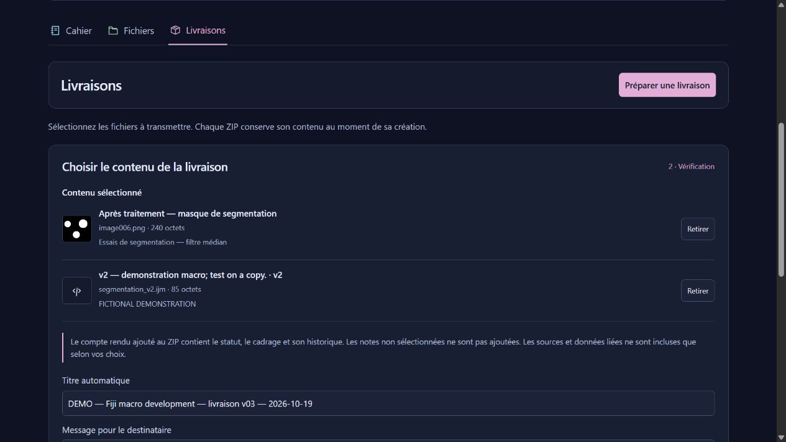

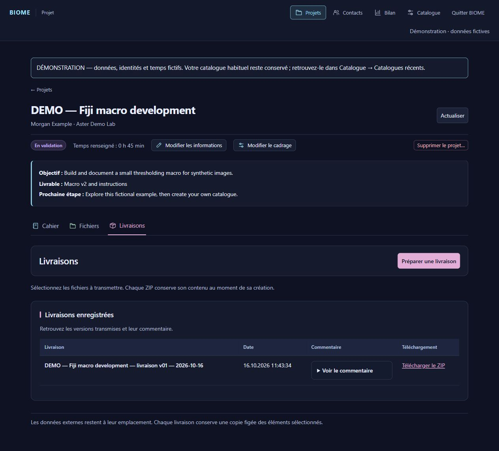

## 9. Contacts and shared categories

**Contacts** adds and edits contacts and groups. Contact email is optional. Corrections update associated project attributions. Distinct names are not automatically merged: reuse consistent group names.

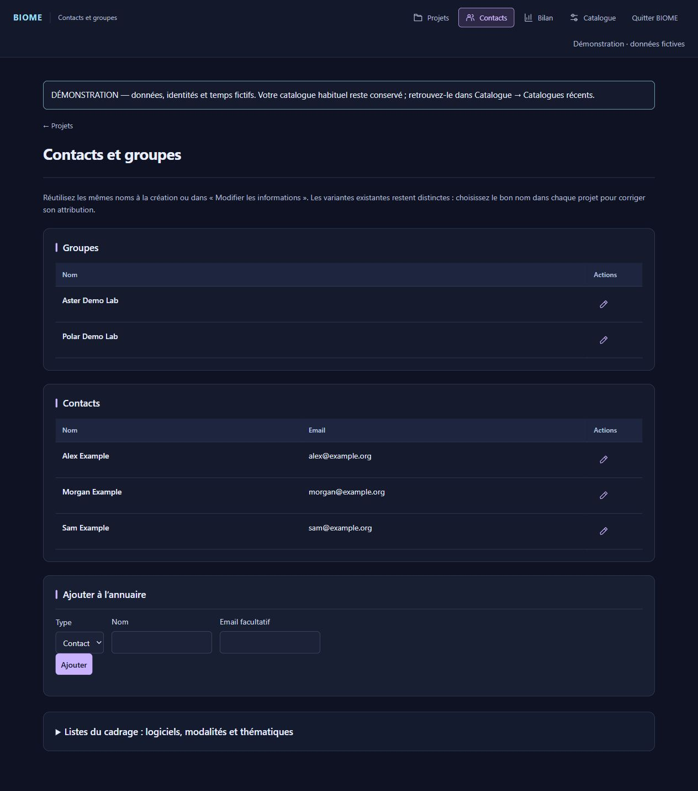

Expand **Listes du cadrage** to maintain software, imaging modalities and topics. Renaming updates associated scopes while retaining history; hiding a value removes it from future choices without removing it from existing projects.

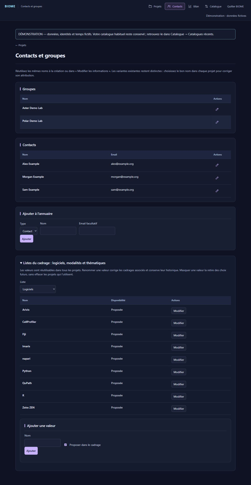

## 10. Read and export activity

**Bilan** accepts a year or inclusive date range. It shows recorded human time, projects with activity, groups and contacts, a timeline and group/intervention charts. Expand category distributions and tables as needed. **Exporter le bilan (ZIP)** includes the dedicated-layout PDF and detailed tabular exports, without browser-print layout.

Time follows session dates. Statuses and categories are current values, not historical snapshots. Missing records do not imply no work. Projects can have multiple software/topics; those counts are not exclusive hour allocations. Undated legacy totals remain separate.

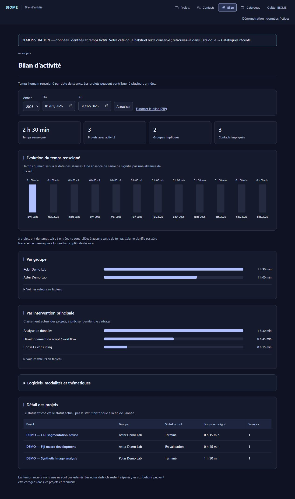

## 11. Check files and access

**Catalogue → Vérifier les dossiers et les accès** checks project metadata, session dates/durations, notebook and attachment links, recorded deliveries and external-location access. It considers all registered locations with progress feedback.

Accessible means a file is present/readable or a folder can be listed. Missing, denied or timed-out locations require checking the path, disk, network or VPN. This read-only control does not validate scientific content, scan every external file for integrity or replace backups.

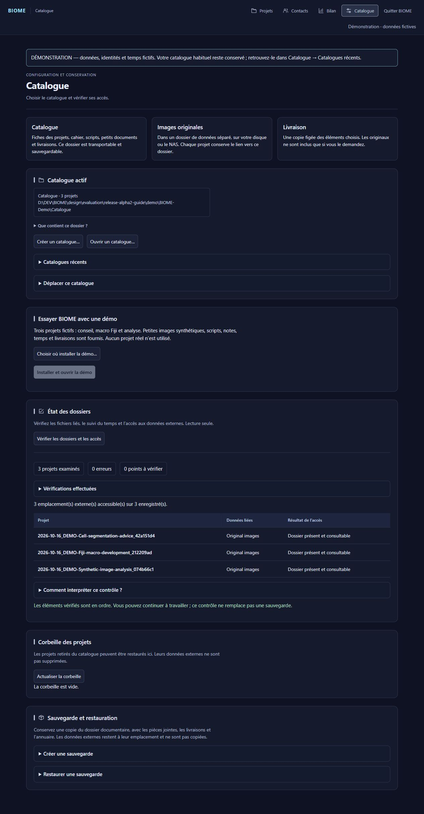

## 12. Recoverable project removal

**Supprimer le projet…** asks for confirmation and moves its documentary folder to BIOME trash. External files stay in place. Restore through **Catalogue → Corbeille des projets → Restaurer**; an existing project is not overwritten. This preview has no permanent-purge command.

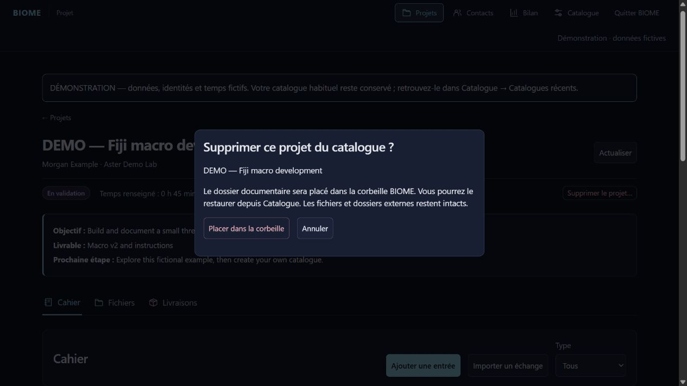

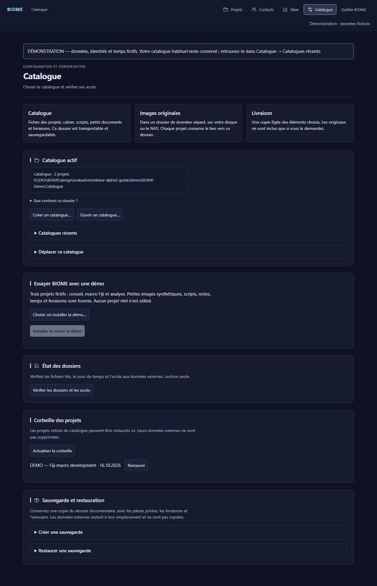

## 13. Backup, restore and relocate

**Créer une sauvegarde** writes a verified catalogue backup outside the catalogue, including documents, attachments, deliveries and directory. Avoid external edits during copying. Original data requires a separate backup.

**Restaurer une sauvegarde** validates the ZIP and creates a new folder at the selected destination, preserving the current catalogue.

**Déplacer ce catalogue** copies and verifies the catalogue, then switches to the new location. The previous copy remains as a safety copy; subsequent changes are independent. Check the active path before working. External original data stays at its existing location.

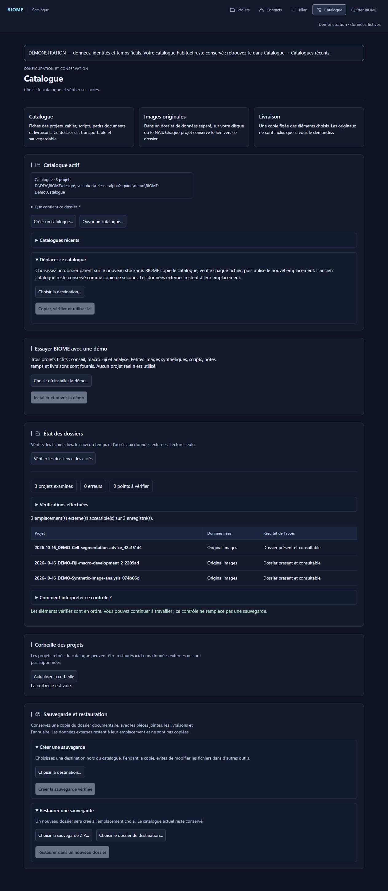

## Legacy data and feedback

The folder-based redesign is not a drop-in replacement for the legacy React/SQLite/Tauri data format. This release does not include a universal BIOME 2.x database migration. Preserve old data and backups; historical recovery needs separate review.

When reporting a problem, include version, steps and expected result using a fictional example. Do not upload real catalogues, research images, private emails or credentials. Development and issues belong in [BIOME-next](https://github.com/UniversalBuilder/BIOME-next).

## Alpha 6: project list and report coverage

The project list now has separate sortable **Groupe / laboratoire** and **Contact** columns. Group labels may identify a PI, laboratory, department or facility. Existing names are preserved; brackets are not required to distinguish a group label from its contact.

Each report breakdown shows included and excluded project counts. Time by group or intervention requires both the category and recorded time. Software, modality and topic counts only require the category. Explicitly recorded zero remains valid. Projects without recorded time are available in expandable report details. Coverage is calculated among projects with documented activity in the selected period.

Total time includes all recorded sessions, even those without a category, so it can exceed a breakdown total. CSV and PDF exports use the same rules; **coverage.csv** lists inclusion and exclusion counts and reasons. Exported project details retain every project in the period.

## Alpha 7: running version and directory removal

The running version is displayed in the header. If another release is still active, the new launcher asks you to click **Quitter BIOME** in the old window and launch the new version again. Closing only the browser window can leave the local server active.

In **Contacts**, click **Supprimer…**. Unused records can be removed after confirmation. Linked records require a replacement of the same type; affected projects are listed first. Create a replacement beforehand if needed. **Réattribuer et supprimer** updates project identities and the contact email before removing the old record. Reports use the new attributions. Notes, deliveries and history are preserved. Trashed projects remain unchanged; restoring one may reintroduce an old record.
